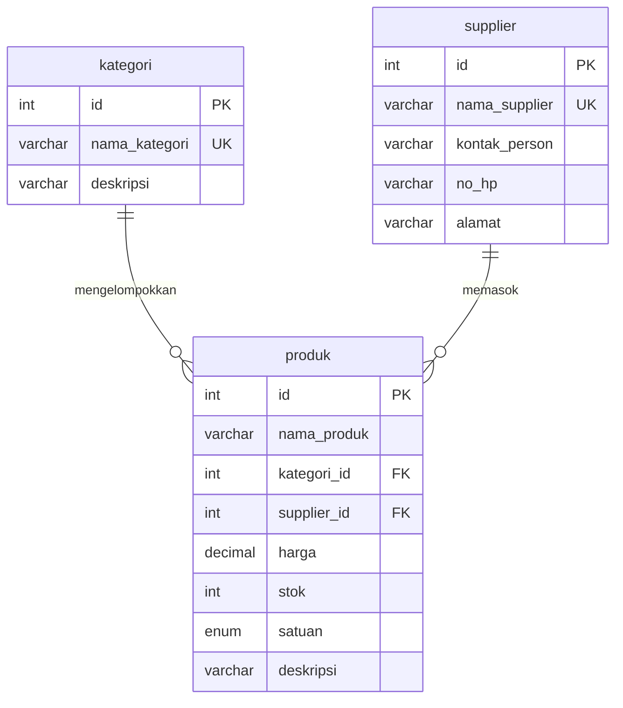

# Budi Frozen — Aplikasi Pencatatan Produk Frozen Food

Aplikasi web sederhana untuk mencatat produk frozen food milik **Pak Budi**. Dibuat dengan **PHP Native + MySQL (XAMPP)** tanpa framework, sehingga mudah dipelajari dan dijelaskan.

---

## 🌐 Demo Online

Klik untuk membuka aplikasi: **https://empirical-decor-computer-downloadable.trycloudflare.com**

> Demo berjalan dari komputer pengembang, jadi hanya aktif selama server menyala.

---

## Fitur

1. **Pencatatan produk** — tambah, lihat, ubah, dan hapus produk (nama, harga, stok, satuan, deskripsi).
2. **Pengelolaan kategori** — CRUD kategori produk.
3. **Pengelolaan supplier** — CRUD supplier/pemasok.
4. **Pengelompokan per kategori** — setiap produk wajib terhubung ke satu kategori; daftar produk dapat difilter per kategori.
5. **Pengelompokan per supplier** — setiap produk wajib terhubung ke satu supplier; daftar produk dapat difilter per supplier.
6. **Dashboard** — total produk, kategori, supplier, nilai stok, peringatan stok menipis, dan grafik sebaran produk per kategori.
7. **Pencarian & filter stok** — cari nama produk, filter kategori/supplier, dan tampilkan hanya produk dengan stok menipis.
8. **Pengamanan** — prepared statement (anti SQL injection), escape HTML (anti XSS), token CSRF, dan konfirmasi hapus.

---

## Teknologi

| Bagian   | Teknologi                              |
|----------|----------------------------------------|
| Backend  | PHP 8.x (native, PDO)                  |
| Database | MySQL / MariaDB (XAMPP)                |
| Frontend | HTML, CSS, JavaScript (tanpa framework)|
| Server   | Apache XAMPP atau PHP built-in server  |

---

## Struktur Database

Database: **`toko_frozen_food`** — 3 tabel utama dengan relasi.



### Relasi dan aturan hapus

| Relasi | Jenis | Aturan |
|---|---|---|
| `produk.kategori_id` → `kategori.id` | many-to-one | `ON DELETE RESTRICT` — kategori tidak bisa dihapus selama masih dipakai produk |
| `produk.supplier_id` → `supplier.id` | many-to-one | `ON DELETE RESTRICT` — supplier tidak bisa dihapus selama masih memasok produk |

Aplikasi juga memeriksa relasi ini di sisi PHP sebelum menghapus, sehingga pengguna mendapat pesan yang jelas (bukan error database).

---

## Struktur Folder

```
frozenfood/
├── config/
│   └── config.php          # koneksi database + konfigurasi
├── database/
│   └── frozenfood.sql      # struktur tabel + data contoh (import ini)
├── includes/
│   ├── fungsi.php          # helper: escape, CSRF, rupiah, pagination
│   ├── header.php          # layout atas + sidebar
│   └── footer.php          # layout bawah
├── assets/
│   ├── css/style.css
│   └── js/app.js
├── produk/                 # index, form, hapus
├── kategori/               # index, form, hapus
├── supplier/               # index, form, hapus
├── index.php               # dashboard
├── jalankan.bat            # launcher Windows (opsional)
└── README.md
```

---

## Cara Menjalankan

### 1. Import database

Pastikan **MySQL** XAMPP sudah berjalan, lalu:

**a. Lewat phpMyAdmin**
1. Buka `http://localhost/phpmyadmin`
2. Menu **Import** → pilih `database/frozenfood.sql` → **Go**

**b. Lewat terminal (CMD)**
```bat
cd C:\path\ke\frozenfood
C:\xampp\mysql\bin\mysql.exe -u root < database\frozenfood.sql
```

### 2. Jalankan aplikasi

**Cara A — paling mudah (Windows):**
```
Klik dua kali file jalankan.bat
```
Script menyalakan MySQL bila perlu, membuka browser ke `http://localhost:8000`, lalu menjalankan PHP server.

**Cara B — lewat Apache XAMPP:**
1. Copy folder `frozenfood` ke `C:\xampp\htdocs\frozenfood`
2. Start **Apache** dan **MySQL**
3. Buka `http://localhost/frozenfood`

**Cara C — manual:**
```bat
cd C:\path\ke\frozenfood
C:\xampp\php\php.exe -S localhost:8000 -t .
```

Tidak ada halaman login — aplikasi langsung terbuka di dashboard.

---

## Konfigurasi Database

Jika pengaturan MySQL Anda berbeda, ubah di `config/config.php`:

```php
define('DB_HOST', '127.0.0.1');
define('DB_PORT', '3306');
define('DB_NAME', 'toko_frozen_food');
define('DB_USER', 'root');
define('DB_PASS', '');       // default XAMPP kosong
```

Batas peringatan stok menipis juga bisa diubah di sana:

```php
define('STOK_MENIPIS', 10);
```

---

## Alur Penggunaan

1. Buka menu **Kategori** → tambah kategori (misal *Nugget & Sosis*).
2. Buka menu **Supplier** → tambah supplier (misal *PT Frozen Nusantara*).
3. Buka menu **Produk** → tambah produk, pilih kategori dan supplier, isi harga dan stok.
4. Di halaman **Produk**, gunakan dropdown **kategori** atau **supplier** untuk menampilkan produk per kelompok, atau centang **Stok menipis**.
5. Klik ikon pensil untuk mengubah produk, ikon tempat sampah untuk menghapus.

---

## Catatan

- Harga disimpan sebagai `DECIMAL(12,2)` dan ditampilkan dalam format Rupiah.
- Stok bertipe bilangan bulat dan tidak boleh negatif.
- Satu kategori/supplier boleh memiliki banyak produk, tetapi satu produk hanya boleh memiliki satu kategori dan satu supplier.
- Data contoh sudah disertakan di `database/frozenfood.sql` (5 kategori, 4 supplier, 12 produk).
